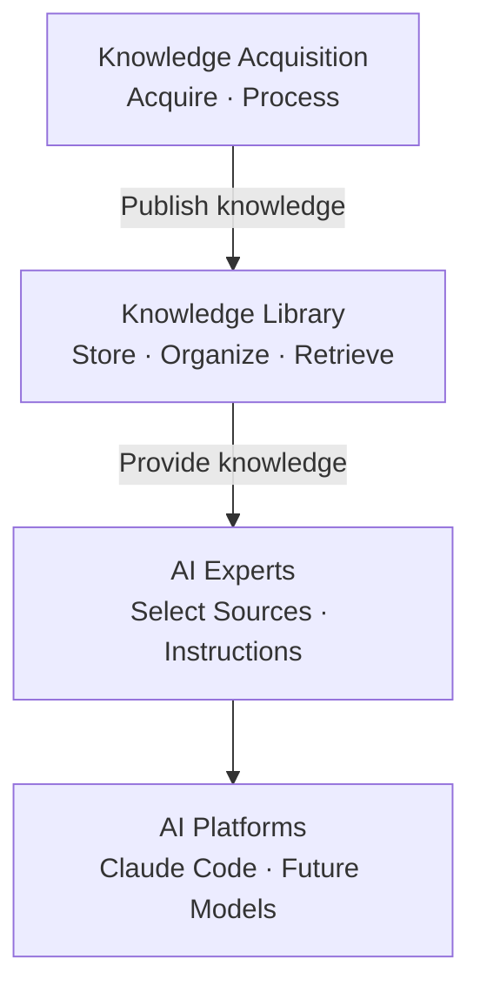
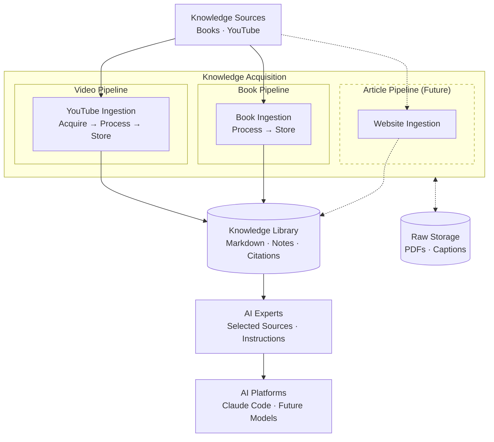

# MyAiExperts — Software Architecture

MyAiExperts helps users build personalized AI experts from knowledge they trust.

## Overview

MyAiExperts has three domain areas:

| Domain | Responsibility | Classification |
|---|---|---|
| **Knowledge Acquisition** | Acquire and process external knowledge | Supporting |
| **Knowledge Library** | Store, organize, index, search and retrieve knowledge | Supporting |
| **AI Experts** | Create personalized experts from selected knowledge and instructions | **Core** |

**Knowledge Acquisition produces knowledge → Knowledge Library manages and retrieves it → AI Experts use it.**

AI Experts is the core: it's what makes the product worth having. Acquisition and the library are needed,
but they're kept simple. These are logical domain boundaries, not separate services.

Source: [`diagrams/domain-flow.mmd`](diagrams/domain-flow.mmd).



Raw storage supports Knowledge Acquisition: it preserves the original sources so they can be
reprocessed offline, without downloading again.

## System Architecture

Source: [`diagrams/architecture.mmd`](diagrams/architecture.mmd).



YouTube's rate limit is the hard constraint: about 50 requests a day, and one 429 means waiting
24 hours. Much of the video pipeline exists to never trigger one.

## Knowledge Acquisition

Source-specific pipelines, the original material they collect, and their own bookkeeping:

```text
knowledge-acquisition/
├── pipelines/
│   ├── book-pipeline/
│   │   └── book_ingestion/       # process.py, store.py (PDFs are added by hand)
│   └── video-pipeline/
│       └── youtube_ingestion/    # acquire.py, process.py, store.py, request_guard.py
├── raw/
│   ├── books/                # original PDFs
│   └── youtube/              # caption snapshots, bookmarklet captures
└── state/                    # acquisition metadata and operational state
```

It owns:
- **Acquiring** source material, within YouTube's request limits.
- **Preserving** originals in `raw/`.
- **Processing** sources into citation-ready Markdown.
- **Publishing** processed documents to the Knowledge Library.
- **Tracking** what it knows about each source: video lists, status and retries, the request guard, the run lock and the book list.

Each pipeline keeps its own `acquire.py`, `process.py` and `store.py`; there is no shared ingestion
framework. `store.py` handles both the pipeline's own files and publishing to the library, and stays inside
each package. There is no `processed/` folder: processed knowledge is what the library holds.

| Pipeline | Diagram | Details |
|---|---|---|
| Video | [`video-pipeline.mmd`](diagrams/video-pipeline.mmd) | [youtube.md](youtube.md): commands, rate limits, file formats, bookmarklet |
| Book | [`book-pipeline.mmd`](diagrams/book-pipeline.mmd) | [books.md](books.md): PDF conversion, notes format, citation rules |
| Article (future) | | Website ingestion, added as its own pipeline when needed |

## Knowledge Library

Processed knowledge and everything needed to find and cite it.

**Today** it is plain Markdown, and Claude Code retrieves knowledge by searching and reading the files:

```text
knowledge-library/
├── books/<slug>/
│   ├── chapters/             # NN-title.md with <!-- p.N --> page markers
│   └── notes.md              # written by /extract-book
└── youtube/<slug>/
    ├── transcripts/          # <date>-<title>-<id>.md with [mm:ss] paragraphs, plus INDEX.md
    └── missing.log           # videos with no transcript, so experts can say what isn't covered
```

Everything here can be rebuilt from `raw/` (`./scripts/yt.sh reprocess`, `./scripts/books.sh --force`),
except `notes.md`, which is curated.

**Why retrieval belongs here, not in AI Experts.** Finding the relevant passage and its citation is the same
job for every expert. If each expert did it its own way, every expert would duplicate it and search would
behave differently from one expert to the next. An expert's job is to choose *which* sources it may use and
*how* it answers. The library's job is to find the evidence in them.

**Future.** When plain file search stops being enough, the library may get its own code:

```text
knowledge-library/
├── library/
│   ├── documents.py          # document management and metadata
│   ├── collections.py        # collections and source organization
│   ├── indexing.py           # full-text and semantic search indexing
│   └── retrieval.py          # relevant passages, source filtering, citation references
└── data/
    ├── books/
    └── youtube/
```

At that point Knowledge Acquisition publishes documents through a Knowledge Library interface instead of
writing its files directly, and experts retrieve through the library instead of searching files. None of
this exists yet: no placeholder modules, databases or indexes until there is a real need.

## AI Experts

```text
experts/
└── <expert-name>/
    └── expert.md
```

Each expert owns:
- Its identity and purpose.
- The knowledge sources it may use (`sources:` in the frontmatter).
- Its expert-specific instructions.
- Its rules for evidence-grounded answers and citations: cite, or say the sources don't cover it.

Experts never hold copies of knowledge documents. They point at library collections, so the same
knowledge serves several experts. New experts start from `experts/_template/`.

`.claude/skills/<name>/SKILL.md` is the Claude Code adapter: a thin file that tells Claude when to use an
expert and to read its `expert.md`. It is an integration, not a domain; other platforms would get their own
adapter.

## Storage Ownership

Each domain owns its own files, so the library holds only what experts read:

| Files | Owner |
|---|---|
| `knowledge-acquisition/raw/`: PDFs, caption snapshots, bookmarklet captures | Acquisition |
| `knowledge-acquisition/state/`: rate-limit guard, run lock, video lists, status and retries, `books.txt`, OCR caches | Acquisition |
| `knowledge-library/`: transcripts, `INDEX.md`, `missing.log`, chapters, `notes.md` | Library |
| `experts/`, `.claude/skills/` | AI Experts, adapter |

Tests check this boundary: a pipeline run leaves nothing in the library but published files. Data from
before this layout is moved by `scripts/migrate-storage.py` (a dry run by default; `--apply` moves).

## Supporting Components

| Folder | Purpose |
|---|---|
| `scripts/` | CLI entry points: `yt.sh`, `books.sh`, `test.sh` (all run in Docker) |
| `docs/` | Architecture and pipeline documentation; Mermaid sources in `docs/diagrams/` |

Git holds only the tools and `experts/_template/`. Sources, knowledge, experts and skills stay local.

## Guidelines

- Keep the working pipelines; change structure only when it helps, not to satisfy DDD.
- Keep `acquire.py`, `process.py` and `store.py` source-specific; no shared ingestion framework.
- Keep raw content separate from processed knowledge; no `processed/` folder.
- Retrieval is a Knowledge Library responsibility, not an AI Experts one.
- No pipeline depends on an expert; experts depend only on the library.
- Don't build future library capabilities (indexing, semantic search, databases) before they're needed.
